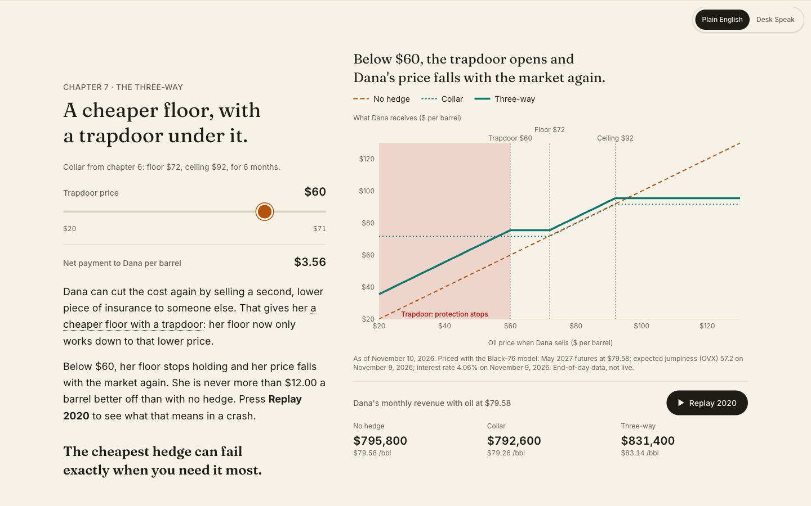
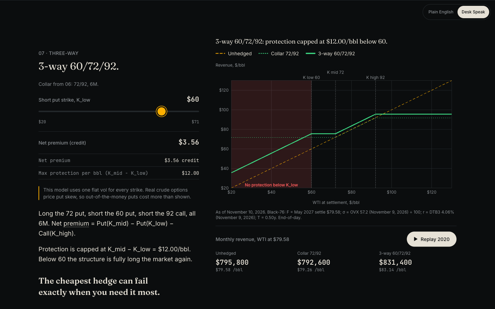

# Hedge Lab

**How oil producers hedge, explained live.**

Hedge Lab is a scroll-through site that teaches commodity derivatives by following one fictional oil producer, Dana, through her hedging decisions: a swap, a put, a collar and a three-way, each priced off real market data that refreshes every weekday. Every screen works on two levels. A beginner reads a story in plain English and drags sliders; a trader flips one switch to Desk Speak and sees strikes, Greeks and vol points on the same chart. Same chart, two vocabularies.

**Live site:** https://hedge-lab-gamma.vercel.app

| Plain English | Desk Speak |
| --- | --- |
|  |  |

## What's in it

Ten chapters on one page, each ending on one takeaway:

0. Today's WTI price, and one question
1. Meet Dana: what a $1 move in oil does to her month
2. Oil's mood swings: daily prices since 2007, with realized vol
3. The futures curve: contango, backwardation and roll yield
4. The swap: lock in the 12-month strip
5. The put: Black-76 pricing, Greeks, and a vol bump
6. The collar: a solver finds the zero-cost call strike
7. The three-way: cheaper, with a trapdoor
8. Is insurance cheap right now? Implied vs realized vol, ranked over 3 years
9. The hedge desk: build your own structure, stress it on 2008, 2014, 2020 and 2022, and share it as a link

## Data sources

All data is end-of-day. A scheduled job fetches it once each weekday evening and saves one file; the site reads only that file, so a feed outage never breaks the page.

| Data | Source | Series |
| --- | --- | --- |
| WTI futures: front month and the next 12 contract months | [Yahoo Finance](https://finance.yahoo.com/quote/CL%3DF/) | `CL=F`, `CLZ26.NYM`, ... |
| WTI spot price history | [FRED](https://fred.stlouisfed.org/series/DCOILWTICO) | `DCOILWTICO` |
| Crude oil implied volatility (OVX) | [FRED](https://fred.stlouisfed.org/series/OVXCLS) | `OVXCLS` |
| 3-month Treasury bill rate | [FRED](https://fred.stlouisfed.org/series/DTB3) | `DTB3` |

## How the pricing works

- **Options are priced with Black-76**, the standard model for options on futures. F is the futures price for the option's month, vol is OVX ÷ 100, and r is the 3-month T-bill rate. Greeks, the zero-cost collar solver (bisection) and the three-way payoff are built on it.
- **The swap price is the 12-month strip**: the plain average of the next 12 monthly futures prices.
- **Realized vol is 30-day, annualized**: √252 × the standard deviation of daily log returns over 21 trading days. Contract roll days are skipped, and windows that include a price at or below zero (April 2020) are left blank.

All of the math is in one file, [`lib/pricing.ts`](lib/pricing.ts), runs in the browser, and is covered by unit tests against known values.

### Stated limitations

- **Flat vol.** One implied vol is used for every strike. Real crude options price put skew, so out-of-the-money puts cost more than shown.
- **OVX is a proxy.** It is built from options on the USO oil ETF, not CME options on crude futures. It is a good public number, not the vol a desk would quote.
- **End-of-day data.** Prices update once a day, not tick by tick, and the FRED spot series can lag by about a week. Every chart shows its as-of date.
- **Monthly-average settlement.** The stress test settles each month at its average price, as real crude swaps do. That makes the options closer to Asian options; pricing them with Black-76 is an approximation.

This is an educational project, not investment advice.

## Run it locally

You need [Node.js](https://nodejs.org) 20 or newer and a free [FRED API key](https://fred.stlouisfed.org/docs/api/api_key.html).

```bash
git clone https://github.com/jihomoon1/hedge-lab.git
cd hedge-lab
npm install

# Put your FRED key in a file that is never committed
echo "FRED_API_KEY=your_key_here" > .env.local

npm run dev
```

Then open http://localhost:3000/api/refresh once to fetch the data (it saves to a local `.data/` folder), and open http://localhost:3000 to see the site.

```bash
npm test        # unit tests for the pricing math, scenarios and share links
npm run lint    # code style checks
npm run build   # production build
```

## Built with

Next.js (App Router) and TypeScript, Tailwind CSS, Recharts, Framer Motion, Vitest, and Vercel (hosting, a daily cron job and Blob storage for the data file). The full build spec is in [`SPEC.md`](SPEC.md).

Built by [Jiho Moon](https://www.linkedin.com/in/jihomoonn).
